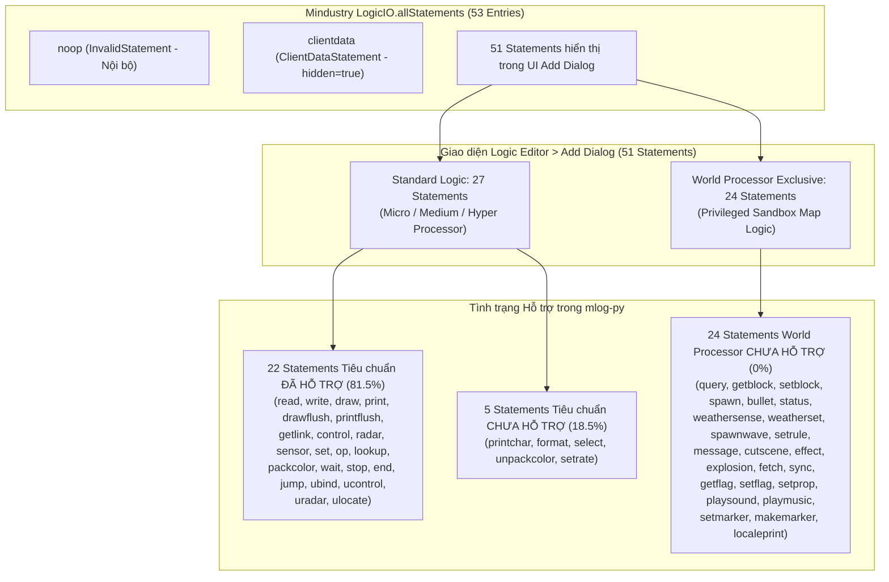

# Mindustry Logic Statement & Opcode Coverage

Tài liệu này đối chiếu toàn diện giữa:
1. **Giao diện người dùng Logic Editor (menu "Add")** của Mindustry (`LogicDialog.java` & `bundle.properties`).
2. **Mã nguồn lõi Mindustry** (`Mindustry/core/src/mindustry/logic/` bao gồm `LStatements.java`, `LExecutor.java`, `LogicIO.java`, `LAccess.java`, `LogicOp.java`, `ConditionOp.java`, `LUnitControl.java`, v.v.).
3. **Trình biên dịch và DSL mlog-py** (`src/compiler.py`, `src/metadata.py`, `src/mlog_registry.py`, `src/validator.py`, cùng hệ thống test `tests/`).

---

## 1. Tổng quan Kiến trúc UI & Phân nhóm Statement

Trong Mindustry Logic Editor, người chơi mở menu **"Add"** để thêm một khối lệnh mới vào bộ vi xử lý (`LogicDialog.java:300-340`). Hệ thống hiển thị statement dựa trên các quy tắc lọc nghiêm ngặt từ mã nguồn Mindustry:

```java
for(Prov<LStatement> prov : LogicIO.allStatements){
    LStatement example = prov.get();
    if(example instanceof InvalidStatement || example.hidden() || (example.privileged() && !privileged) || (example.nonPrivileged() && privileged) ||
        (!text.isEmpty() && !example.localizedName().toLowerCase(Locale.ROOT).contains(text) && !example.typeName().toLowerCase(Locale.ROOT).contains(text)) ||
        (!privileged && !state.rules.logicUnitControl && example.category() == LCategory.unit)) continue;
    ...
}
```

### 1.1. Phân định Số lượng Statement UI vs Opcode Đăng ký

Cần phân biệt rạch ròi giữa số lượng statement hiển thị trên UI và số opcode được đăng ký trong máy ảo Mindustry:

- **Tổng số mục trong `LogicIO.allStatements`**: **53 entries**
  1. `InvalidStatement` (`noop`): Lệnh nội bộ, bị loại khỏi UI bởi kiểm tra `example instanceof InvalidStatement`.
  2. `ClientDataStatement` (`clientdata`): Thuộc tính `privileged() = true` nhưng có `@Override public boolean hidden() { return true; }` (`LStatements.java:2007`), do đó **hoàn toàn bị ẩn khỏi UI "Add"**.
  3. **51 Statements thực sự xuất hiện trên giao diện UI Add Dialog**.

- **Phân loại hiển thị theo chế độ bộ vi xử lý**:
  - **Bộ vi xử lý thông thường (Micro / Medium / Hyper Processor, `privileged = false`)**:
    - Hiển thị chính xác **27 statements** thuộc 5 danh mục: `io` (6), `block` (6), `operation` (6), `control` (5), `unit` (4).
    - Các lệnh có `privileged() = true` bị loại bỏ bởi điều kiện `(example.privileged() && !privileged)`.
  - **Bộ vi xử lý thế giới (World Processor, `privileged = true`)**:
    - Hiển thị toàn bộ 27 statements thông thường **cộng thêm 24 statements đặc quyền** thuộc danh mục `world`.
    - Tổng số statement hiển thị: **51 statements** (27 Standard + 24 World).

### 1.2. Thống kê Tỷ lệ Hỗ trợ (Coverage Metrics)

- **Bộ vi xử lý thông thường (27 UI Statements)**:
  - Đã hỗ trợ trong `mlog-py`: **22 statements** (**81.48%**)
  - Chưa hỗ trợ: **5 statements** (`printchar`, `format`, `select`, `unpackcolor`, `setrate`)
- **Bộ vi xử lý thế giới (24 World-only UI Statements)**:
  - Đã hỗ trợ trong `mlog-py`: **0 / 24 statements** (**0.0%**)
- **Toàn bộ giao diện Logic Editor (51 UI Statements)**:
  - Đã hỗ trợ trong `mlog-py`: **22 / 51 statements** (**43.14%**)
- **Tổng số Opcode MLog có thể xuất hiện (52 opcodes hữu hiệu, trừ `noop`)**:
  - Đã hỗ trợ trong `mlog-py`: **22 / 52 opcodes** (**42.31%**)



---

## 2. Bảng Ma trận Đối chiếu Toàn bộ 51 Statement UI (+ 1 Hidden)

> [!NOTE]
> - Cột **Tên UI**: Chuỗi định danh hiển thị trên nút bấm trong game (`Core.bundle.get("instruction.<key>")`).
> - Cột **Cú pháp MLog thực tế**: Thứ tự token assembly chính xác khi xuất/nhập file MLog (`LogicIO.java` / `LAssembler.java`).
> - Cột **Cấp độ hỗ trợ**: Phân biệt giữa **Cú pháp Python tự nhiên (Pythonic syntax)** và **Compiler Intrinsic** (hàm tích hợp của DSL).

### 2.1. Input & Output (`LCategory.io` — 6 Statements)

| Tên UI | Opcode | Cú pháp MLog thực tế | Trạng thái | Cấp độ Hỗ trợ trong `mlog-py` | Bằng chứng Source | Test liên quan |
| :--- | :--- | :--- | :---: | :--- | :--- | :--- |
| **Read** | `read` | `read <output> <target> <address>` | **Đã hỗ trợ** | • **Pythonic**: Đọc mảng `dest = arr[i]`<br>• **Intrinsic**: `dest = read(cell, addr)` hoặc `read(dest, cell, addr)` | Mindustry: `LStatements.java:63`<br>mlog-py: `src/compiler.py:865` (intrinsic), `src/compiler.py:615-645` (subscript) | `tests/test_phase1e.py:47`<br>`tests/test_phase1f.py:284`<br>`tests/test_array.py:100` |
| **Write** | `write` | `write <input> <target> <address>` | **Đã hỗ trợ** | • **Pythonic**: Gán mảng `arr[i] = val`, `arr[i] += val`<br>• **Intrinsic**: `write(val, cell, addr)` | Mindustry: `LStatements.java:93`<br>mlog-py: `src/compiler.py:887` (intrinsic), `src/compiler.py:1232-1307` (subscript) | `tests/test_phase1e.py:59`<br>`tests/test_phase1f.py:284`<br>`tests/test_array.py:130`<br>`tests/test_aug_assign.py` |
| **Draw** | `draw` | `draw <type> <x> <y> <p1> <p2> <p3> <p4>` | **Đã hỗ trợ** | • **Intrinsic**: `draw(type, x, y, p1, p2, p3, p4)` dùng `DrawType.<TYPE>` hoặc chuỗi literal | Mindustry: `LStatements.java:123`<br>mlog-py: `src/compiler.py:898`, `src/metadata.py:503` | `tests/test_phase1e.py:22`<br>`tests/test_phase1f.py:267` |
| **Print** | `print` | `print <value>` | **Đã hỗ trợ** | • **Pythonic / Intrinsic**: `print(value)` (đẩy vào text buffer, tự động format số/chuỗi) | Mindustry: `LStatements.java:263`<br>mlog-py: `src/compiler.py:928`, `src/metadata.py:180` | `tests/test_phase1e.py:40`<br>`tests/test_print_buffer_semantics.py` |
| **Print Char** | `printchar` | `printchar <value>` | **Chưa hỗ trợ** | *(Chưa có intrinsic hoặc hàm cú pháp tương ứng)* | Mindustry: `LStatements.java:284`<br>mlog-py: Chưa có trong `compiler.py` | *(Chưa có test)* |
| **Format** | `format` | `format <value>` | **Chưa hỗ trợ** | *(Chưa có intrinsic / chưa hạ bậc f-string)* | Mindustry: `LStatements.java:324`<br>mlog-py: Chưa có trong `compiler.py` | *(Chưa có test)* |

---

### 2.2. Block Control (`LCategory.block` — 6 Statements)

| Tên UI | Opcode | Cú pháp MLog thực tế | Trạng thái | Cấp độ Hỗ trợ trong `mlog-py` | Bằng chứng Source | Test liên quan |
| :--- | :--- | :--- | :---: | :--- | :--- | :--- |
| **Draw Flush** | `drawflush` | `drawflush <target>` | **Đã hỗ trợ** | • **Intrinsic**: `drawflush(display)` | Mindustry: `LStatements.java:345`<br>mlog-py: `src/compiler.py:919`, `src/metadata.py:523` | `tests/test_phase1e.py:34`<br>`tests/test_phase1f.py:267` |
| **Print Flush** | `printflush` | `printflush <target>` | **Đã hỗ trợ** | • **Intrinsic**: `printflush(message)` | Mindustry: `LStatements.java:366`<br>mlog-py: `src/compiler.py:939`, `src/metadata.py:205` | `tests/test_phase1e.py:40`<br>`tests/test_print_buffer_semantics.py` |
| **Get Link** | `getlink` | `getlink <output> <address>` | **Đã hỗ trợ** | • **Intrinsic**: `dest = getlink(index)` hoặc `getlink(dest, index)` | Mindustry: `LStatements.java:387`<br>mlog-py: `src/compiler.py:1164`, `src/metadata.py:964` | `tests/test_registry.py:148`<br>`tests/test_decompiler_dest_var_recovery.py:74` |
| **Control** | `control` | `control <type> <target> <p1> <p2> <p3> <p4>` | **Đã hỗ trợ** | • **Intrinsic**: `control(type, target, p1, p2, p3, p4)` dùng `ControlProperty.<PROP>` | Mindustry: `LStatements.java:413`<br>mlog-py: `src/compiler.py:972`, `src/metadata.py:446` | `tests/test_phase1e.py:77` |
| **Radar** | `radar` | `radar <t1> <t2> <t3> <sort> <turret> <order> <out>` | **Đã hỗ trợ** | • **Intrinsic**: `dest = radar(t1, t2, t3, sort, turret, order)` hoặc `radar(...)` | Mindustry: `LStatements.java:460`<br>mlog-py: `src/compiler.py:1025`, `src/metadata.py:758` | `tests/test_registry.py:136`<br>`tests/test_phase2_golden.py:106` |
| **Sensor** | `sensor` | `sensor <to> <from> <type>` | **Đã hỗ trợ** | • **Intrinsic**: `val = sensor(block, prop)` hoặc `sensor(val, block, prop)` | Mindustry: `LStatements.java:524`<br>mlog-py: `src/compiler.py:948`, `src/metadata.py:416` | `tests/test_phase1e.py:65` |

---

### 2.3. Operations (`LCategory.operation` — 6 Statements)

| Tên UI | Opcode | Cú pháp MLog thực tế | Trạng thái | Cấp độ Hỗ trợ trong `mlog-py` | Bằng chứng Source | Test liên quan |
| :--- | :--- | :--- | :---: | :--- | :--- | :--- |
| **Set** | `set` | `set <to> <from>` | **Đã hỗ trợ** | • **Pythonic**: Gán biến `a = b`<br>• **Intrinsic**: `set(a, b)` | Mindustry: `LStatements.java:651`<br>mlog-py: `src/compiler.py:772`, `src/compiler.py:1226` | `tests/test_phase1a.py:10`<br>`tests/test_phase1f.py:22` |
| **Operation** | `op` | `op <op> <dest> <a> <b>` | **Đã hỗ trợ** | • **Pythonic**: Toán tử số học, bitwise, so sánh gán biến, hàm `min()`, `max()`<br>• **Intrinsic**: `dest = op(name, a, b)` (hỗ trợ toàn bộ 45 LogicOp) | Mindustry: `LStatements.java:676`<br>mlog-py: `src/compiler.py:784`, `src/compiler.py:538-665` | `tests/test_phase1a.py:33`<br>`tests/test_phase1e.py:10`<br>`tests/test_bitwise_support.py`<br>`tests/test_min_max_support.py` |
| **Select** | `select` | `select <result> <op> <comp0> <comp1> <a <b>` | **Chưa hỗ trợ** | *(Ternary Python `a if c else b` hiện biên dịch thành 2 jump rẽ nhánh thay vì opcode `select`)* | Mindustry: `LStatements.java:740`<br>mlog-py: Chưa có hạ bậc `select` trong `compiler.py` | *(Chưa có test cho opcode `select`)* |
| **Lookup** | `lookup` | `lookup <type> <result> <id>` | **Đã hỗ trợ** | • **Intrinsic**: `dest = lookup(type, id)` dùng `LookupType.<TYPE>` | Mindustry: `LStatements.java:822`<br>mlog-py: `src/compiler.py:1114`, `src/metadata.py:890` | `tests/test_registry.py:148`<br>`tests/test_source_mapping.py:477` |
| **Pack Color** | `packcolor` | `packcolor <result> <r> <g> <b> <a>` | **Đã hỗ trợ** | • **Intrinsic**: `dest = packcolor(r, g, b, a)` | Mindustry: `LStatements.java:856`<br>mlog-py: `src/compiler.py:1138`, `src/metadata.py:931` | `tests/test_registry.py:148`<br>`tests/test_decompiler_dest_var_recovery.py:98` |
| **Unpack Color** | `unpackcolor` | `unpackcolor <r> <g> <b> <a> <color>` | **Chưa hỗ trợ** | *(Đã có trong `validator.py:36` & `decompiler`, nhưng thiếu intrinsic trong `compiler.py`)* | Mindustry: `LStatements.java:884`<br>mlog-py: `validator.py:36` | `tests/test_decompiler_dest_var_recovery.py:250` (chỉ decompiler) |

---

### 2.4. Flow Control (`LCategory.control` — 5 Statements)

| Tên UI | Opcode | Cú pháp MLog thực tế | Trạng thái | Cấp độ Hỗ trợ trong `mlog-py` | Bằng chứng Source | Test liên quan |
| :--- | :--- | :--- | :---: | :--- | :--- | :--- |
| **Wait** | `wait` | `wait <seconds>` | **Đã hỗ trợ** | • **Intrinsic**: `wait(seconds)` hoặc `wait()` (mặc định 0.5s) | Mindustry: `LStatements.java:783`<br>mlog-py: `src/compiler.py:1198`, `src/metadata.py:659` | `tests/test_phase1e.py:101` |
| **Stop** | `stop` | `stop` | **Đã hỗ trợ** | • **Pythonic / Intrinsic**: Lệnh trần `stop` hoặc gọi hàm `stop()` | Mindustry: `LStatements.java:804`<br>mlog-py: `src/compiler.py:1211`, `src/metadata.py:675` | `tests/test_phase1e.py:101` |
| **End** | `end` | `end` | **Đã hỗ trợ** | • **Pythonic / Intrinsic**: Lệnh trần `end` hoặc gọi hàm `end()` | Mindustry: `LStatements.java:912`<br>mlog-py: `src/compiler.py:1217`, `src/metadata.py:691` | `tests/test_phase1e.py:101` |
| **Jump** | `jump` | `jump <target> <cond> <a> <b>` | **Đã hỗ trợ** | • **Pythonic**: `if`, `elif`, `else`, `while`, `for ... in range()`, `break`, `continue`<br>• **Intrinsic**: `jump(target, cond, a, b)` | Mindustry: `LStatements.java:930`<br>mlog-py: `src/compiler.py:841`, `src/compiler.py:1495-1804` | `tests/test_phase1c.py:10`<br>`tests/test_phase1d.py:11`<br>`tests/test_phase1f.py:75, 119`<br>`tests/test_for_loop.py` |
| **Set Rate** | `setrate` | `setrate <amount>` | **Chưa hỗ trợ** | *(Chưa có intrinsic / hàm cú pháp)* | Mindustry: `LStatements.java:1891`<br>mlog-py: Chưa có trong `compiler.py` | *(Chưa có test)* |

---

### 2.5. Unit Control (`LCategory.unit` — 4 Statements)

| Tên UI | Opcode | Cú pháp MLog thực tế | Trạng thái | Cấp độ Hỗ trợ trong `mlog-py` | Bằng chứng Source | Test liên quan |
| :--- | :--- | :--- | :---: | :--- | :--- | :--- |
| **Unit Bind** | `ubind` | `ubind <type>` | **Đã hỗ trợ** | • **Intrinsic**: `ubind(unit_type)` dùng `Units.<TYPE>` hoặc chuỗi literal | Mindustry: `LStatements.java:1020`<br>mlog-py: `src/compiler.py:994`, `src/metadata.py:711` | `tests/test_phase1e.py:83` |
| **Unit Control** | `ucontrol` | `ucontrol <type> <p1> <p2> <p3> <p4> <p5>` | **Đã hỗ trợ** | • **Intrinsic**: `ucontrol(action, p1, p2, p3, p4, p5)` dùng `UnitControl.<ACTION>` | Mindustry: `LStatements.java:1063`<br>mlog-py: `src/compiler.py:1004`, `src/metadata.py:474` | `tests/test_phase1e.py:89` |
| **Unit Radar** | `uradar` | `uradar <t1> <t2> <t3> <sort> 0 <order> <out>` | **Đã hỗ trợ** | • **Intrinsic**: `dest = uradar(t1, t2, t3, sort, order)` | Mindustry: `LStatements.java:1104`<br>mlog-py: `src/compiler.py:1063`, `src/metadata.py:817` | `tests/test_phase1e.py:95`<br>`tests/test_registry.py:136` |
| **Unit Locate** | `ulocate` | `ulocate <type> <flag> <enemy> <ore> <outX> <outY> <outFound> <outBuild>` | **Đã hỗ trợ** | • **Intrinsic**: `ulocate(locate, flag, enemy, ore, outX, outY, outFound, outBuild)` | Mindustry: `LStatements.java:1128`<br>mlog-py: `src/compiler.py:1184`, `src/metadata.py:853` | `tests/test_decompiler_dest_var_recovery.py:225` (round-trip qua compiler)<br>`tests/test_semantic_argument_recovery.py:223` |

---

### 2.6. World Processor / Privileged (`LCategory.world` — 24 UI Statements + 1 Hidden)

> [!IMPORTANT]
> Tất cả các statement dưới đây có thuộc tính `privileged() = true` trong Mindustry lõi (`LStatements.java`), chỉ được phép sử dụng trong **World Processor**. Hiện tại `mlog-py` chưa hỗ trợ tập lệnh này (chưa có IR node, chưa có intrinsic trong `compiler.py`, validator và decompiler sẽ báo lỗi cú pháp không xác định).

| STT | Tên UI | Opcode | Cú pháp MLog thực tế | Trạng thái | Bằng chứng Source Mindustry |
| :---: | :--- | :--- | :--- | :---: | :--- |
| 1 | **Query** | `query` | `query <target> <filter> <filter2> <type> <p1> <p2> <p3> <p4>` | **Chưa hỗ trợ** | `LStatements.java:1218`, `LExecutor.java:1894` |
| 2 | **Get Block** | `getblock` | `getblock <layer> <result> <x> <y>` | **Chưa hỗ trợ** | `LStatements.java:1270`, `LExecutor.java:1913` |
| 3 | **Set Block** | `setblock` | `setblock <layer> <block> <x> <y> <team> <rotation>` | **Chưa hỗ trợ** | `LStatements.java:1306`, `LExecutor.java:1931` |
| 4 | **Spawn Unit** | `spawn` | `spawn <type> <x> <y> <rotation> <team> <result>` | **Chưa hỗ trợ** | `LStatements.java:1357`, `LExecutor.java:1950` |
| 5 | **Spawn Bullet** | `bullet` | `bullet <type> <team> <x> <y> <angle> <velocity> <lifetime>` | **Chưa hỗ trợ** | `LStatements.java:1388`, `LExecutor.java:1967` |
| 6 | **Apply Status** | `status` | `status <clear> <status> <unit> <duration>` | **Chưa hỗ trợ** | `LStatements.java:1430`, `LExecutor.java:1984` |
| 7 | **Weather Sense** | `weathersense` | `weathersense <result> <weather>` | **Chưa hỗ trợ** | `LStatements.java:1494`, `LExecutor.java:2001` |
| 8 | **Weather Set** | `weatherset` | `weatherset <active> <weather>` | **Chưa hỗ trợ** | `LStatements.java:1548`, `LExecutor.java:2018` |
| 9 | **Spawn Wave** | `spawnwave` | `spawnwave <x> <y> <natural>` | **Chưa hỗ trợ** | `LStatements.java:1598`, `LExecutor.java:2035` |
| 10 | **Set Rule** | `setrule` | `setrule <rule> <p1> <p2> <p3> <p4>` | **Chưa hỗ trợ** | `LStatements.java:1625`, `LExecutor.java:2052` |
| 11 | **Flush Message** | `message` | `message <type> <timeout> <field> <target>` | **Chưa hỗ trợ** | `LStatements.java:1693`, `LExecutor.java:2070` |
| 12 | **Cutscene** | `cutscene` | `cutscene <type> <p1> <p2> <p3> <p4>` | **Chưa hỗ trợ** | `LStatements.java:1736`, `LExecutor.java:2087` |
| 13 | **Effect** | `effect` | `effect <type> <x> <y> <rotation> <color> <p1>` | **Chưa hỗ trợ** | `LStatements.java:1797`, `LExecutor.java:2104` |
| 14 | **Explosion** | `explosion` | `explosion <team> <x> <y> <radius> <damage> <air> <ground> <pierce>` | **Chưa hỗ trợ** | `LStatements.java:1858`, `LExecutor.java:2121` |
| 15 | **Fetch** | `fetch` | `fetch <type> <result> <team> <index> <extra>` | **Chưa hỗ trợ** | `LStatements.java:1911`, `LExecutor.java:2138` |
| 16 | **Sync** | `sync` | `sync <target>` | **Chưa hỗ trợ** | `LStatements.java:1968`, `LExecutor.java:2155` |
| 17 | **Get Flag** | `getflag` | `getflag <result> <flag>` | **Chưa hỗ trợ** | `LStatements.java:2029`, `LExecutor.java:2189` |
| 18 | **Set Flag** | `setflag` | `setflag <flag> <value>` | **Chưa hỗ trợ** | `LStatements.java:2061`, `LExecutor.java:2206` |
| 19 | **Set Prop** | `setprop` | `setprop <property> <target> <value>` | **Chưa hỗ trợ** | `LStatements.java:2092`, `LExecutor.java:2223` |
| 20 | **Play Sound** | `playsound` | `playsound <pitch> <volume> <pan> <x> <y> <sound> <limit>` | **Chưa hỗ trợ** | `LStatements.java:2212`, `LExecutor.java:2240` |
| 21 | **Play Music** | `playmusic` | `playmusic <track> <interrupt>` | **Chưa hỗ trợ** | `LStatements.java:2421`, `LExecutor.java:2257` |
| 22 | **Set Marker** | `setmarker` | `setmarker <property> <id> <p1> <p2> <p3> <p4>` | **Chưa hỗ trợ** | `LStatements.java:2450`, `LExecutor.java:2274` |
| 23 | **Make Marker** | `makemarker` | `makemarker <id> <type> <x> <y> <replace>` | **Chưa hỗ trợ** | `LStatements.java:2533`, `LExecutor.java:2291` |
| 24 | **Locale Print** | `localeprint` | `localeprint <property>` | **Chưa hỗ trợ** | `LStatements.java:2576`, `LExecutor.java:2308` |
| *--* | *(Ẩn UI)* | `clientdata` | `clientdata <channel> <value> <reliable>` | **Chưa hỗ trợ** | `LStatements.java:1993` (`hidden() = true`) |

---

## 3. Khảo sát Toàn diện Biến thể (Variants)

### 3.1. Phân định Cấp độ Hỗ trợ cho 45 Phép toán `LogicOp` (`LogicOp.java`)

Toàn bộ 45 phép toán `LogicOp` đều được khai báo trong `REG_LOGIC_OPS` (`src/mlog_registry_data.py:11`). Tuy nhiên, cần phân biệt rõ **hai cấp độ hỗ trợ**:
- **Cấp độ 1 (Cú pháp Python tự nhiên)**: Được parser nhận diện qua cú pháp chuẩn của Python (`+`, `-`, `*`, `min()`, `max()`, v.v.).
- **Cấp độ 2 (Gọi qua Intrinsic `op()`)**: Compiler hỗ trợ hạ bậc qua hàm `dest = op("name", a, b)` hoặc `op("name", dest, a, b)`. Các hàm Python tương đương (như `abs(x)`, `math.sin(x)`) **bị compiler từ chối** nếu viết theo phong cách Python chuẩn.

| Nhóm Phép toán | Tên Enum Java | Token MLog | Ký hiệu UI | Ngôi | Cấp độ 1: Cú pháp Python Tự nhiên | Cấp độ 2: Intrinsic `op()` |
| :--- | :--- | :--- | :---: | :---: | :--- | :--- |
| **Số học nhị phân** | `add` | `add` | `+` | Nhị phân | `a + b`, `a += b` | `op("add", d, a, b)` |
| | `sub` | `sub` | `-` | Nhị phân | `a - b`, `a -= b`, unary `-a` | `op("sub", d, a, b)` |
| | `mul` | `mul` | `*` | Nhị phân | `a * b`, `a *= b` | `op("mul", d, a, b)` |
| | `div` | `div` | `/` | Nhị phân | `a / b`, `a /= b` | `op("div", d, a, b)` |
| | `idiv` | `idiv` | `//` | Nhị phân | `a // b`, `a //= b` | `op("idiv", d, a, b)` |
| | `mod` | `mod` | `%` | Nhị phân | *(C/Java truncated remainder)* | `op("mod", d, a, b)` |
| | `emod` | `emod` | `%%` | Nhị phân | `a % b`, `a %= b` | `op("emod", d, a, b)` |
| | `pow` | `pow` | `^` | Nhị phân | `a ** b`, `a **= b` | `op("pow", d, a, b)` |
| **So sánh & Logic** | `equal` | `equal` | `==` | Nhị phân | `x = a == b` (phát sinh op equal) | `op("equal", d, a, b)` |
| | `notEqual` | `notEqual` | `not` | Nhị phân | `x = a != b` (phát sinh op notEqual) | `op("notEqual", d, a, b)` |
| | `land` | `land` | `and` | Nhị phân | `x = a and b` (trong biểu thức) | `op("land", d, a, b)` |
| | `lessThan` | `lessThan` | `<` | Nhị phân | `x = a < b` | `op("lessThan", d, a, b)` |
| | `lessThanEq` | `lessThanEq` | `<=` | Nhị phân | `x = a <= b` | `op("lessThanEq", d, a, b)` |
| | `greaterThan` | `greaterThan` | `>` | Nhị phân | `x = a > b` | `op("greaterThan", d, a, b)` |
| | `greaterThanEq`| `greaterThanEq`| `>=` | Nhị phân | `x = a >= b` | `op("greaterThanEq", d, a, b)` |
| | `strictEqual` | `strictEqual` | `===` | Nhị phân | `x = a is b`, `x = a is not b` | `op("strictEqual", d, a, b)` |
| **Toán tử Bitwise** | `shl` | `shl` | `<<` | Nhị phân | `a << b`, `a <<= b` | `op("shl", d, a, b)` |
| | `shr` | `shr` | `>>` | Nhị phân | `a >> b`, `a >>= b` | `op("shr", d, a, b)` |
| | `ushr` | `ushr` | `>>>` | Nhị phân | *(Python không có toán tử `>>>`)* | `op("ushr", d, a, b)` |
| | `or` | `or` | `or` | Nhị phân | `a \| b`, `a \|= b` | `op("or", d, a, b)` |
| | `and` | `and` | `b-and` | Nhị phân | `a & b`, `a &= b` | `op("and", d, a, b)` |
| | `xor` | `xor` | `xor` | Nhị phân | `a ^ b`, `a ^= b` | `op("xor", d, a, b)` |
| | `not` | `not` | `flip` | Đơn phân | `~a` (phát sinh op not dest a 0) | `op("not", d, a, 0)` |
| **Hàm Math Dựng sẵn**| `min` | `min` | `min` | Nhị phân | `min(a, b)` | `op("min", d, a, b)` |
| | `max` | `max` | `max` | Nhị phân | `max(a, b)` | `op("max", d, a, b)` |
| | `abs` | `abs` | `abs` | Đơn phân | *(Từ chối `abs(x)`)* | `op("abs", d, x, 0)` |
| | `sign` | `sign` | `sign` | Đơn phân | *(Không có hàm Python)* | `op("sign", d, x, 0)` |
| | `floor` | `floor` | `floor` | Đơn phân | *(Từ chối `math.floor(x)`)* | `op("floor", d, x, 0)` |
| | `ceil` | `ceil` | `ceil` | Đơn phân | *(Từ chối `math.ceil(x)`)* | `op("ceil", d, x, 0)` |
| | `round` | `round` | `round` | Đơn phân | *(Từ chối `round(x)`)* | `op("round", d, x, 0)` |
| | `sqrt` | `sqrt` | `sqrt` | Đơn phân | *(Từ chối `math.sqrt(x)`)* | `op("sqrt", d, x, 0)` |
| | `rand` | `rand` | `rand` | Đơn phân | *(Từ chối `random.random()`)* | `op("rand", d, max, 0)` |
| | `sin` | `sin` | `sin` | Đơn phân | *(Từ chối `math.sin(x)`)* | `op("sin", d, deg, 0)` |
| | `cos` | `cos` | `cos` | Đơn phân | *(Từ chối `math.cos(x)`)* | `op("cos", d, deg, 0)` |
| | `tan` | `tan` | `tan` | Đơn phân | *(Từ chối `math.tan(x)`)* | `op("tan", d, deg, 0)` |
| | `asin` | `asin` | `asin` | Đơn phân | *(Từ chối `math.asin(x)`)* | `op("asin", d, v, 0)` |
| | `acos` | `acos` | `acos` | Đơn phân | *(Từ chối `math.acos(x)`)* | `op("acos", d, v, 0)` |
| | `atan` | `atan` | `atan` | Đơn phân | *(Từ chối `math.atan(x)`)* | `op("atan", d, v, 0)` |
| | `log` | `log` | `log` | Đơn phân | *(Từ chối `math.log(x)`)* | `op("log", d, x, 0)` |
| | `logn` | `logn` | `logn` | Nhị phân | *(Từ chối `math.log(x, b)`)* | `op("logn", d, x, base)` |
| | `log10` | `log10` | `log10` | Đơn phân | *(Từ chối `math.log10(x)`)* | `op("log10", d, x, 0)` |
| | `angle` | `angle` | `angle` | Nhị phân | *(Không có hàm tương đương)* | `op("angle", d, x, y)` |
| | `angleDiff` | `angleDiff` | `anglediff` | Nhị phân | *(Không có hàm tương đương)* | `op("angleDiff", d, a, b)` |
| | `len` | `len` | `len` | Nhị phân | *(Từ chối `math.hypot(x, y)`)* | `op("len", d, x, y)` |
| | `noise` | `noise` | `noise` | Nhị phân | *(Không có hàm tương đương)* | `op("noise", d, x, y)` |

---

### 3.2. Biến thể Jump (`jump`) — 8 Điều kiện So sánh (`ConditionOp.java`)

Được hỗ trợ đầy đủ 100% trong `REG_CONDITIONS` (`src/mlog_registry_data.py:13`) và hạ bậc luồng điều khiển (`src/compiler.py:1495-1804`):
- `equal` (`==`), `notEqual` (`not`), `lessThan` (`<`), `lessThanEq` (`<=`), `greaterThan` (`>`), `greaterThanEq` (`>=`), `strictEqual` (`===`), `always` (`always`).

### 3.3. Biến thể Control (`control`) — 5 Thuộc tính (`LAccess.java:80-86`)

Được hỗ trợ đầy đủ 100% qua `ControlProperty` enum và `REG_CONTROL_PROPERTIES` (`src/mlog_registry_data.py:7`):
- `enabled`, `shoot`, `shootp`, `config`, `color`.

### 3.4. Biến thể Radar & Unit Radar (`radar`, `uradar`)

Được hỗ trợ đầy đủ 100% qua `RadarTarget` (8 filters) và `RadarSort` (5 modes) (`src/mlog_registry_data.py:17-19`):
- **Target Filters**: `any`, `enemy`, `ally`, `player`, `attacker`, `flying`, `boss`, `ground`.
- **Sort Modes**: `distance`, `health`, `shield`, `armor`, `maxHealth`.

### 3.5. Biến thể Sensor (`sensor`) — 68 Thuộc tính Chuẩn (`LAccess.java:5-79`)

Được hỗ trợ đầy đủ 100% các thuộc tính chuẩn qua `SensorProperty` enum và `REG_SENSOR_PROPERTIES` (`src/mlog_registry_data.py:5`):
- Kho chứa & Năng lượng (11): `totalItems`, `firstItem`, `totalLiquids`, `totalPower`, `itemCapacity`, `liquidCapacity`, `powerCapacity`, `powerNetStored`, `powerNetCapacity`, `powerNetIn`, `powerNetOut`.
- Đạn & Bộ nhớ (5): `ammo`, `ammoCapacity`, `currentAmmoType`, `memoryCapacity`, `bufferSize`.
- Máu & Giáp (5): `health`, `maxHealth`, `heat`, `shield`, `armor`.
- Hiệu suất (4): `efficiency`, `progress`, `timescale`, `operations`.
- Động học (8): `rotation`, `x`, `y`, `velocityX`, `velocityY`, `speed`, `size`, `range`.
- Trạng thái bắn (7): `shootX`, `shootY`, `shooting`, `boosting`, `solid`, `dead`, `flying`.
- Khai thác & Xây dựng (6): `mineX`, `mineY`, `mining`, `buildX`, `buildY`, `building`, `breaking`.
- Mạng ping (3): `pingX`, `pingY`, `pingText`.
- Định danh (7): `team`, `type`, `flag`, `controlled`, `controller`, `name`, `id`.
- Màn hình (2): `displayWidth`, `displayHeight`.
- Payload (5): `payloadCount`, `payloadType`, `totalPayload`, `payloadCapacity`, `maxUnits`.
- Đạn & Khối chọn (4): `selectedBlock`, `selectedRotation`, `bulletLifetime`, `bulletTime`.

### 3.6. Biến thể Unit Control (`ucontrol`) — 21 Lệnh Đơn vị (`LUnitControl.java`)

Được hỗ trợ đầy đủ 100% qua `UnitControl` enum và `REG_UNIT_CONTROL` (`src/mlog_registry_data.py:9`):
- `idle`, `stop`, `move`, `approach`, `pathfind`, `autoPathfind`, `boost`, `target`, `targetp`, `itemDrop`, `itemTake`, `payDrop`, `payTake`, `payEnter`, `mine`, `flag`, `build`, `deconstruct`, `getBlock`, `within`, `unbind`.

### 3.7. Biến thể Unit Locate (`ulocate`) — 4 Kiểu Định vị (`LLocate.java`)

Được hỗ trợ đầy đủ 100% qua intrinsic `ulocate(...)` (`src/compiler.py:1184`):
- `ore`, `building`, `spawn`, `damaged`.
- 9 nhóm khối công trình (`BlockGroup`): `core`, `storage`, `generator`, `turret`, `factory`, `repair`, `rally`, `battery`, `reactor`.

### 3.8. Biến thể Lookup (`lookup`) — 5 Kiểu Nội dung (`GlobalVars.java:25`)

Được hỗ trợ đầy đủ 100% qua `LookupType` enum và `REG_LOOKUP_TYPES` (`src/mlog_registry_data.py:306`):
- `item`, `block`, `unit`, `liquid`, `team`.

### 3.9. Biến thể Draw (`draw`) — 16 Thao tác Đồ họa (`LogicDisplay.GraphicsType`)

Được hỗ trợ đầy đủ 100% qua `DrawType` enum và `REG_DRAW_TYPES` (`src/mlog_registry_data.py:15`):
- `clear`, `color`, `col`, `stroke`, `line`, `rect`, `lineRect`, `poly`, `linePoly`, `triangle`, `image`, `print`, `translate`, `scale`, `rotate`, `reset`.

---

## 4. Những Mục Chưa thể Kết luận (Open Architectural Questions)

Trong quá trình đối chiếu mã nguồn, một số khía cạnh kỹ thuật cần được ghi nhận là câu hỏi mở hoặc quyết định thiết kế cần thống nhất với maintainer:

1. **Ngữ nghĩa modulo: `op mod` vs `op emod` (Đã giải quyết theo ADR-001)**:
   - Theo quyết định trong ADR-001 (`docs/adr/0001-modulo-semantics.md`) dành cho Mindustry v8 (`v160.7`), toán tử Python `%` và `%=` được ánh xạ chuẩn sang `op emod` để bảo đảm 100% ngữ nghĩa floored modulo của Python.
   - Opcode `op mod` được bảo toàn nguyên vẹn cho lập trình viên qua intrinsic cấp thấp `op("mod", d, a, b)` và decompiler tự động bảo toàn `op mod` thành lời gọi `op("mod", ...)`.
2. **Hạ bậc biểu thức ba ngôi (Ternary Expression) sang Opcode `select`**:
   - Mindustry v7 cung cấp lệnh `select <result> <op> <comp0> <comp1> <a <b>`.
   - Cú pháp Python `result = a if cond else b` có thể tối ưu thành 1 lệnh `select` duy nhất thay vì 2 lệnh `jump`.
   - *Rào cản ngữ nghĩa*: Python ternary tuân thủ cơ chế đoản mạch (short-circuit: chỉ tính toán nhánh được chọn). Lệnh `select` của MLog đánh giá trước cả hai biến `a` và `b`. Nếu `a` hoặc `b` chứa side-effects (như `read` hoặc lời gọi hàm), việc thay thế bằng `select` sẽ phá vỡ ngữ nghĩa chuẩn của Python.
3. **Cú pháp DSL cho `unpackcolor`**:
   - Opcode `unpackcolor` nhận 1 biến màu đầu vào và giải nén ra 4 biến `r`, `g`, `b`, `a`.
   - Do Python hỗ trợ tuple unpacking (`r, g, b, a = unpackcolor(col)`), đây là ứng viên tự nhiên cho việc bổ sung vào compiler. Tuy nhiên, hiện tại compiler chưa có cơ chế đa biến gán tuple cho hàm intrinsic.
4. **Hạ bậc f-string sang `format` vs chuỗi lệnh `print`**:
   - Mindustry cung cấp lệnh `format <val>` để thay thế placeholder `{0}` trong chuỗi.
   - Khi người dùng viết `f"Score: {score}"`, compiler có thể phát sinh chuỗi `print "Score: " ; print score`, hoặc phát sinh `print "Score: {0}" ; format score`. Cả hai đều đạt kết quả hiển thị tương đương. Cần đánh giá hiệu năng về số byte và giới hạn buffer để chọn giải pháp tối ưu.
